# Modulation Identification: Circular Spectrum of Digital Modulated Signals [with MATLAB Code]

Digital modulation signals are easier to transmit and process compared to analog signals, and they have stronger anti-interference capabilities, which is the main research target of this paper. 
There are two methods for digital modulation: one uses analog key control, also known as keying method. The second treats digital signals as an analog signal and modulates it. The first method is more commonly used, with well-known types including Amplitude Keying (ASK), Frequency Shift Keying (FSK), and Phase Shift Keying (PSK) [37].
Based on the different bit rates, digital signals can be binary or multi-level. Depending on the bit rate of the digital signal being modulated, a corresponding digital modulation signal will be generated.
1. Binary Digital Modulation
During the binary modulation process, the amplitude, frequency, and phase of the generated signal will only change between two different states. Common types include 2ASK, 2FSK, and 2PSK.
1.1 Binary Amplitude Keying (2ASK)
For 2ASK modulation signals, throughout the entire modulation period, the carrier's frequency and phase remain unchanged, while its amplitude value changes between two values. 2ASK signals select whether to control the carrier's ON and OFF based on the binary digital difference. Generally, 2ASK signals can be represented as:
In the formula, a(t) is expressed as:
In the formula, an represents the binary signal, T is the symbol interval of the signal, q(t) is the baseband rectangular pulse waveform, with a width of T.
1.2 Binary Frequency Shift Keying (2FSK)
For 2FSK modulation signals, throughout the entire modulation period, the carrier's amplitude and phase remain unchanged, but its frequency changes between two values according to the binary digital difference. When the signal is 1, the carrier's frequency is w1, and when it is 0, the carrier's frequency is w2. 2FSK signals can be represented as:
2FSK signals can be considered as the superposition of two 2ASK signals.
1.3 Binary Phase Shift Keying (2PSK)
For 2PSK modulation signals, throughout the entire modulation period, the carrier frequency and amplitude remain unchanged, while the phase value of the carrier will vary according to the binary digits. Typically, phase 0 is represented as 0, and phase 180 as 1. The 2PSK signal can be expressed as:

In the formula, θn represents the phase of the nth symbol value:

In 2PSK signals, different binary code elements have opposite polarity but the same waveform, so the 2PSK signal can be rewritten as:

2ASK code elements are either 0 or 1, whereas in 2PSK, code elements are -1 or 1.

Circuit Spectrum

Modulation signals exhibit periodicity, and by analyzing and studying the parameters of the signal's circuit spectrum, it can be concluded that the spectrum correlation function of signals from different modulation methods differs, which allows for the identification and discrimination of signal modulation methods through this characteristic.

Compared to other feature parameters, the characteristics of the circuit spectrum parameters are as follows:
1. It has strong noise resistance. Since the modulation signal has periodicity, while noise does not, the spectral peak formed by noise will only appear at zero frequency.
2. The circuit spectrum peaks contain a large amount of information. By determining the position of the modulation signal's circuit spectrum peaks, we can estimate several modulation parameters of the signal (such as carrier frequency, information rate, etc.)
3. The circuit spectrum images of different modulation signals differ. Due to the excellent noise resistance of the circuit spectrum parameters, we can identify the type of modulation signal in lower SNR environments by analyzing the circuit spectrum parameters of the signal.

There are many algorithms for calculating the signal's circuit spectrum, with three commonly used ones being FAM algorithm based on FFT transformation (FFT Accumulation Method), estimation algorithms based on time domain smoothing, and estimation algorithms based on frequency domain smoothing [45-46].

The algorithm adopted in this paper is the time domain smoothing periodic method for calculating the signal's circuit spectrum, with the following steps:
(1) Calculate the N-point spectrum of x(n) over a time length of T.
The following is the derivation process of the power spectral function of a signal using the Wiener-Khinchin theorem:
In the formula, R(x) is the autocorrelation function of the signal, a is the cyclic frequency, and S(f) is the cyclic spectral density function of the signal.
Next, we calculate the cyclic spectral density function S(f) of a finite signal x(t). First, a finite signal x(t) is sampled with a rectangular window (centered at t, width T), and the spectrum of x(t) is X(f). The spectrum of the signal after sampling is defined as XT(t, f).
In this formula, a short-time Fourier transform is applied to x(t), which is equivalent to passing through a frequency filter centered at f with a bandwidth of 1/T.
(2) Spectral correlation calculation
We shift the XT(t, f) spectrum towards both sides by a/2 and -a/2, obtaining the time-varying spectra U(t, f) and V*T(t, f). Here, a is the cyclic frequency,
Using the method shown in the formula below, perform multiplication operations on U(t, f) and V*T(t, f), then smooth the result with a window width of 1T using mean smoothing, and finally obtain the cyclic spectral density function S(f):
(3) Spectral smoothing
Substituting the values of U(t, f) and V*T(t, f) into the formula above yields:
For each specific cyclic frequency a, calculate its cyclic spectral density function, and after completing the iteration, obtain the complete cyclic spectral parameter matrix S(f) of the finite signal.
MATLAB code
% =============================================\n% ---------------- Loop Spectrum Simulation -----------\n% --------------Program internal parameters such as code rate can be set\n% =============================================\nclear all;\nclc;\nclose all;\n​\nFc=1.0e+8;% Frequency of operation\nFsc=4*Fc;\nFd=2.5e+7;% Symbol Rate\nFs=4.0e+8;       %--------System Sampling Frequency !!!!!!!!\ntone=5.0e+7 ;\n    %---------Modulation Signal---------\n    m=2;\nnumSymb=64  ;% Number of simulation information code lines\nx=randsrc(numSymb,1,[0:m-1]);%---------Generate 25 binary random codes\nx1=dmod(x,Fc,Fd,Fs,'fsk',m,tone);\nx2=dmod(x,Fc,Fd,Fs,'psk',m);\nx3=dmod(x,Fc,Fd,Fs,'ask',m);\nx4=dmod(x,Fc,Fd,Fs,'msk');\n​\nnumModPlot=numSymb*Fs/Fd;%--Attention to the number of points to be modulated--%\nt=[0:numModPlot-1]'./Fs;\nfigure(1)\nsubplot(411);\nplot(t,x1(1:length(t)),'b-');\naxis([min(t) max(t) -1.5 1.5]);\ntitle('fskModulated signal');\nxlabel('Time');\nylabel('Amplitude');\n​\nsubplot(412);\nplot(t,x2(1:length(t)),'b-');\naxis([min(t) max(t) -1.5 1.5]);\ntitle('pskModulated signal');\nxlabel('Time');\nylabel('Amplitude');\n​\nsubplot(413);\nplot(t,x3(1:length(t)),'b-');\naxis([min(t) max(t) -1.5 1.5]);\ntitle('askModulated signal');\nxlabel('Time');\nylabel('Amplitude');\n​\nsubplot(414);\nplot(t,x4(1:length(t)),'b-');\naxis([min(t) max(t) -1.5 1.5]);\ntitle('mskModulated signal');\nxlabel('Time');\nylabel('Amplitude');\n​\nfigure(2)\n​\nn1=length(x1);\ny1=fft(x1)/n1;\nf=(-Fs/2:Fs/n1:Fs/2-Fs/n1);\nsubplot(4,1,1);\nplot(f,fftshift(abs(y1)));\ntitle('FSKSignalFFTSpectrum');\nxlabel('Frequency');\nylabel('Amplitude(Normalized)');\n​\nn2=length(x2);\ny2=fft(x2)/n2;\nf=(-Fs/2:Fs/n2:Fs/2-Fs/n2);\nsubplot(4,1,2);\nplot(f,fftshift(abs(y2)));\ntitle('PSKSignalFFTSpectrum');\nxlabel('Frequency');\nylabel('Amplitude(Normalized)');\n​\nn3=length(x3);\ny3=fft(x3)/n3;\nf=(-Fs/2:Fs/n3:Fs/2-Fs/n3);\nsubplot(4,1,3);\nplot(f,fftshift(abs(y3)));\ntitle('ASKSignalFFTSpectrum');\nxlabel('Frequency');\nylabel('Amplitude(Normalized)');\n​\n​\nn4=length(x4);\ny4=fft(x4)/n4;\nf=(-Fs/2:Fs/n4:Fs/2-Fs/n4);\nsubplot(4,1,4);\nplot(f,fftshift(abs(y4)));\ntitle('MSKSignalFFTSpectrum');\nxlabel('Frequency');\nylabel('Amplitude(Normalized)');\n​\n%----------------------Add Gaussian White Noise---------------------\nfigure(3)\nSNRperbit=5;\nadjSNR=SNRperbit-10*log10(Fs/Fd)+10*log10(log2(m));\n​\nY1=awgn(x1,adjSNR, 'measured', [], 'dB');\nsubplot(411);\nplot(t,Y1(1:length(t)),'r');\ntitle('FSKSignal with Gaussian white noise');\nylabel('Amplitude');\nxlabel('Time');\n​\nY2=awgn(x2,adjSNR, 'measured', [], 'dB');\nsubplot(412);\nplot(t,Y2(1:length(t)),'r');\ntitle('PSKSignal with Gaussian white noise');\nylabel('Amplitude');\nxlabel('Time');\n​\nY3=awgn(x3,adjSNR, 'measured', [], 'dB');\nsubplot(413);\nplot(t,Y3(1:length(t)),'r');\ntitle('ASKSignal with Gaussian white noise');\nylabel('Amplitude');\nxlabel('Time');\n​\nY4=awgn(x4,adjSNR, 'measured', [], 'dB');\nsubplot(414);\nplot(t,Y4(1:length(t)),'r');\ntitle('MSKSignal with Gaussian white noise');\nylabel('Amplitude');\nxlabel('Time');\n​\nfigure(4)\nN1=fft(x1)/n1;\nsubplot(4,1,1);\nplot(f,fftshift(abs(N1)));\ntitle('FSKSignal with Gaussian white noiseFFTSpectrum');\nxlabel('Frequency');\nylabel('Amplitude(Normalized)');\n​\nN2=fft(x2)/n2;\nsubplot(4,1,2);\nplot(f,fftshift(abs(N2)));\ntitle('PSKSignal with Gaussian white noiseFFTSpectrum');\nxlabel('Frequency');\nylabel('Amplitude(Normalized)');\n​\nN3=fft(x3)/n3;\nsubplot(4,1,3);\nplot(f,fftshift(abs(N3)));\ntitle('ASKSignal with Gaussian white noiseFFTSpectrum');\nxlabel('Frequency');\nylabel('Amplitude(Normalized)');\n​\n​\nN4=fft(x4)/n4;\nsubplot(4,1,4);\nplot(f,fftshift(abs(N4)));\ntitle('MSKSignal with Gaussian white noiseFFTSpectrum');\nxlabel('Frequency');\nylabel('Amplitude(Normalized)');\n​\n​\n%-----------------------------------------------------\n% Smoothing method for cyclic spectrum correlation in time domain using cycle plot\n​\n​\n%figure(2)\n%N=numModPlot;M=64;s1=y';\n%S=cyclic_cross_periodogram1(s1,s1,N,M,'hamming','hamming');\n%-----------------------------------------------\n% Periodogram Frequency Domain Smoothing Method for Circular Spectrum Correlation\nN=2048;\nM=32;\nK=round(1.5*N*Fc/Fsc);          % Frequency axis\nalfa=round(1.5*N*Fc/Fsc);  % Loop frequency axis\n​\nG1=cyclic_function(Y1,N,M,K,alfa,Fs,Fsc);\nG2=cyclic_function(x2,N,N,K,alfa,Fs,Fsc);\nG3=cyclic_function(x3,N,M,K,alfa,Fs,Fsc);\nG4=cyclic_function(x4,N,N,K,alfa,Fs,Fsc);\nSimulation results  
Time-domain waveform graph  
Spectrum graph  
FSK cyclic spectrum  
PSK cyclic spectrum  
ASK cyclic spectrum  
MSK cyclic spectrum

## Images

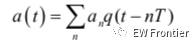
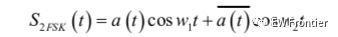
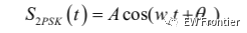
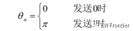
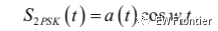
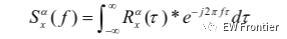
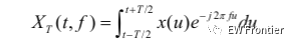
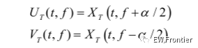
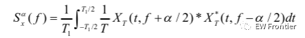
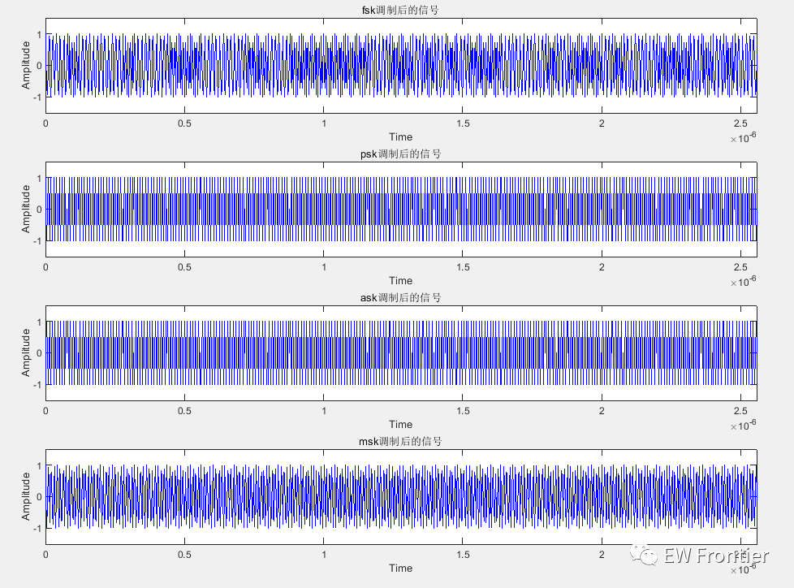
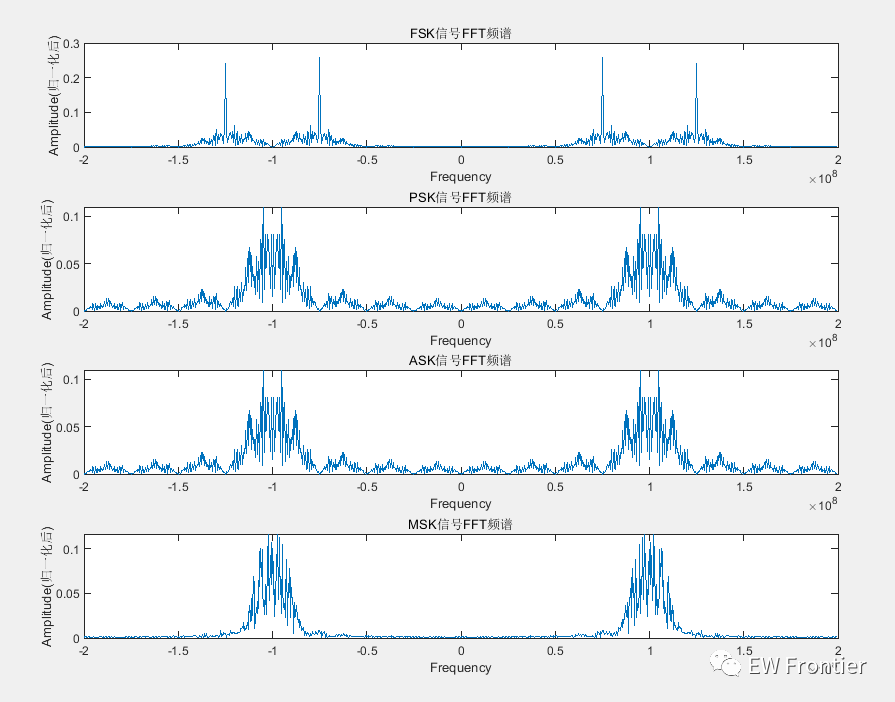
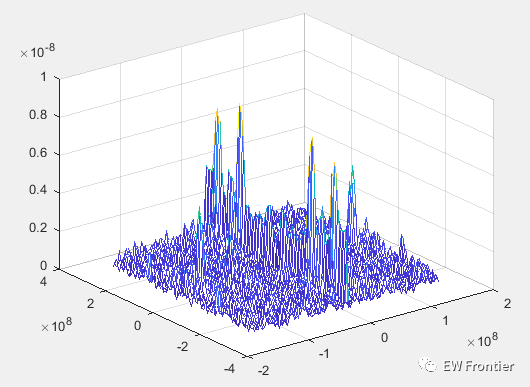
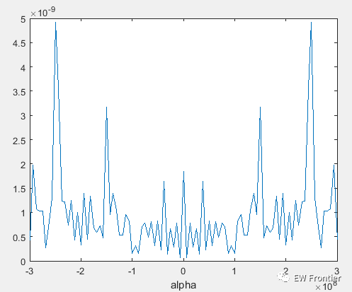
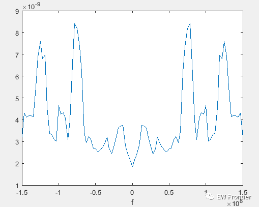
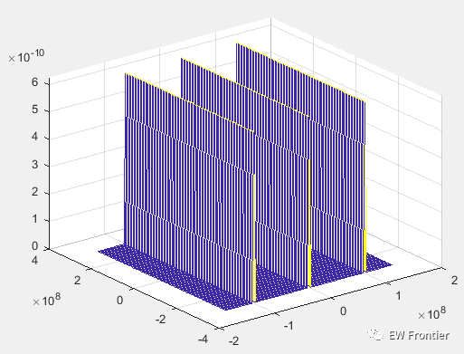
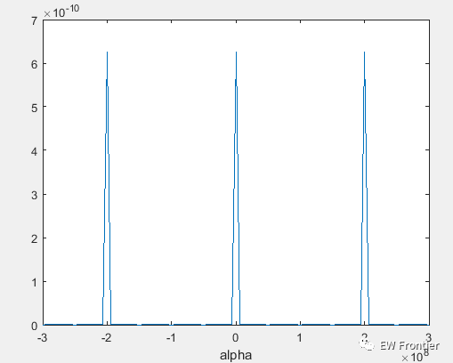
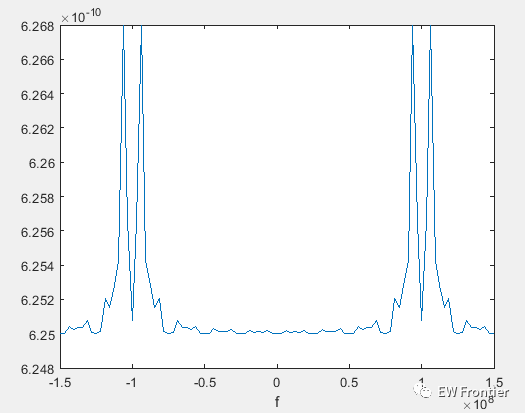
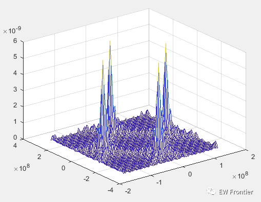
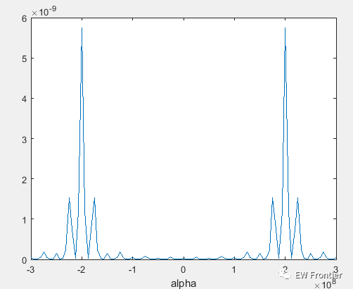
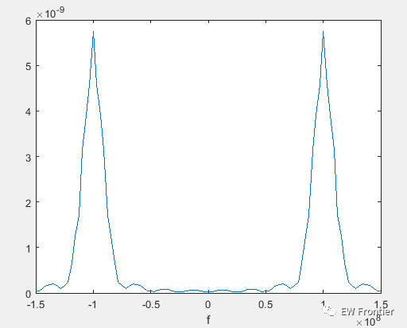
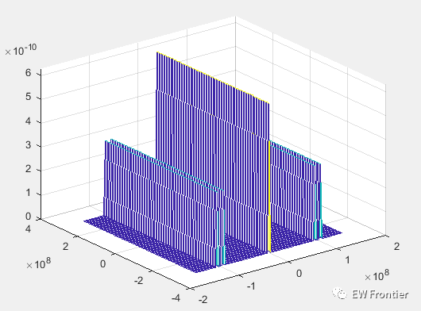
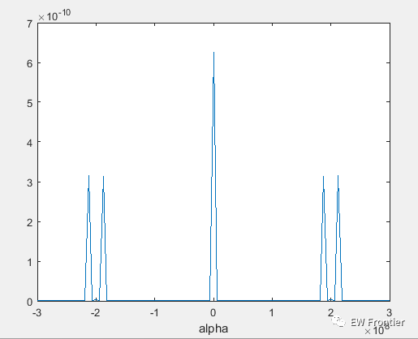
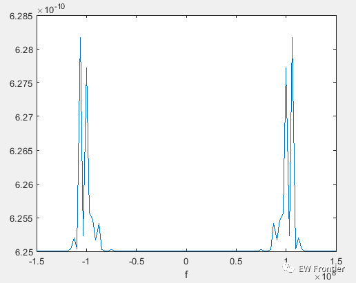

<!-- PAYMENT_BLOCK -->

## Get this dataset

- Payment link (Stripe): [Buy now](https://buy.stripe.com/3cs8yP7sY87d0vu9AB)
- Payment QR code: 

<!-- /PAYMENT_BLOCK -->
